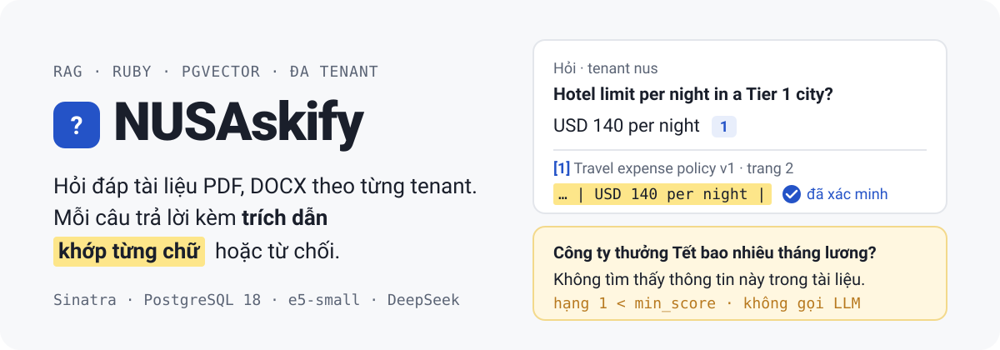
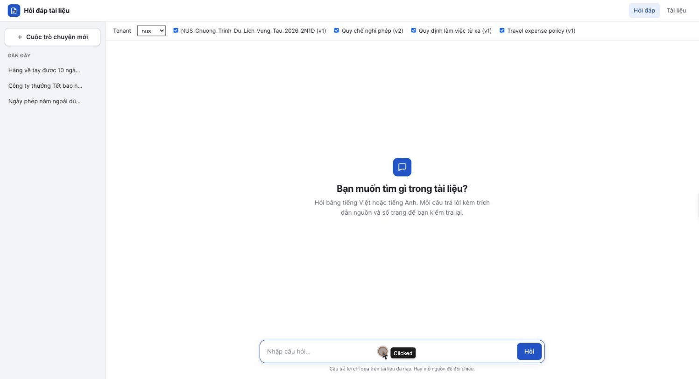
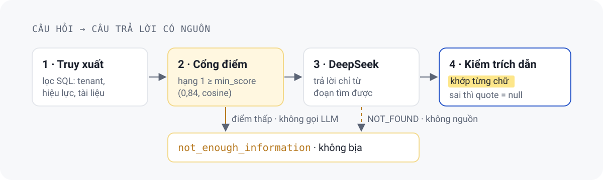
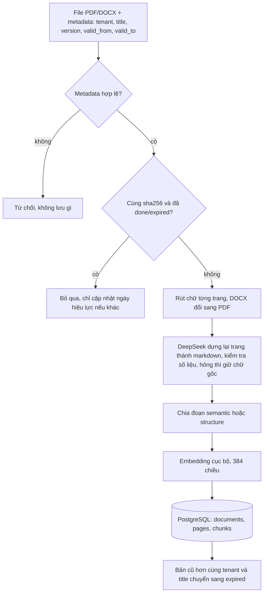
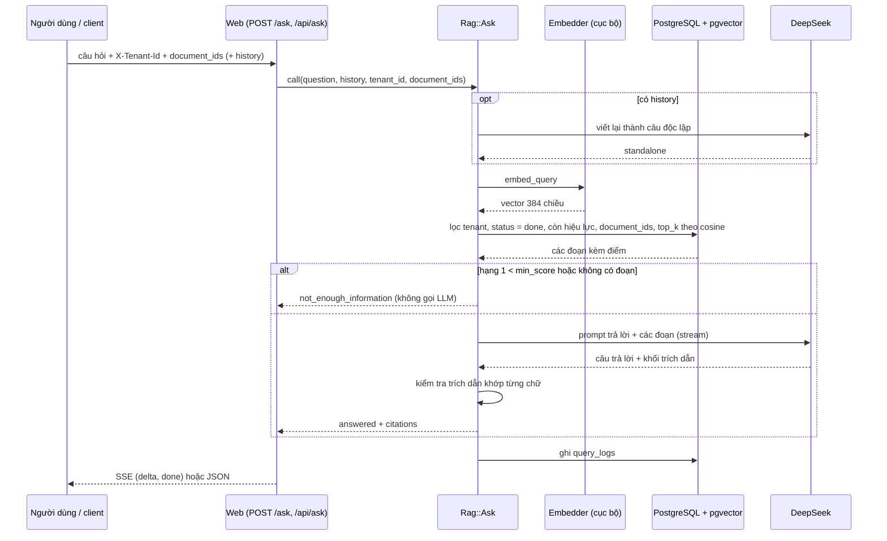
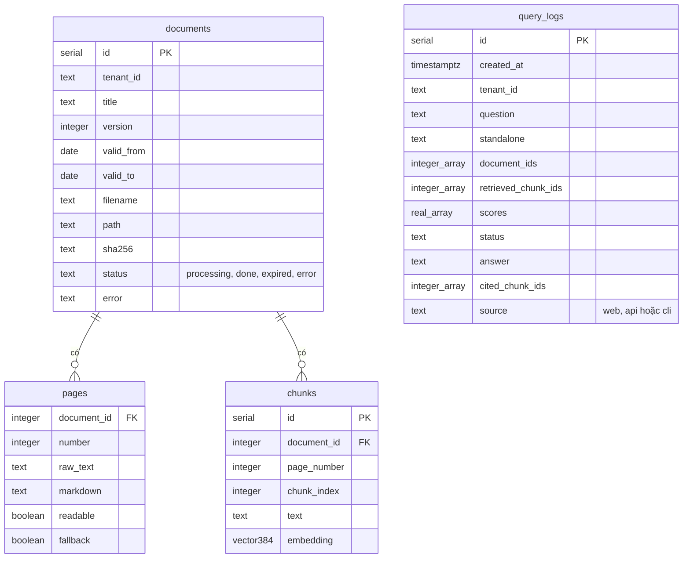

<p align="center">
  
</p>

<p align="center">
  
</p>

Nạp file PDF và Word (.docx) kèm metadata (tenant, tiêu đề, phiên bản, ngày hiệu lực), rồi hỏi bằng tiếng Việt hoặc tiếng Anh. Câu trả lời hiện dần và kèm nguồn: tài liệu, phiên bản, số trang, đoạn trích.

- **Trích dẫn được kiểm bằng code.** Mỗi đoạn trích phải nằm nguyên văn trong đoạn đã nạp (bỏ qua dòng kẻ bảng `|---|`); không khớp thì `quote` là `null`.
- **Không có thì nói không có.** Điểm truy xuất thấp hơn `min_score` thì trả `Không tìm thấy thông tin này trong tài liệu.` (API: `not_enough_information`) và không gọi mô hình.
- **Tách tenant và phiên bản bằng SQL.** Lọc `tenant_id`, trạng thái và ngày hiệu lực ngay trong câu truy vấn vector, trước khi xếp hạng.

Giao diện: trang chat (`/`) với checkbox chọn tài liệu theo tenant, bảng `Đoạn tìm được` kèm điểm tương đồng; các cuộc trò chuyện lưu trên trình duyệt (localStorage, tối đa 50, tách theo tenant). Trang `Tài liệu` (`/documents`) để tải lên, xem từng trang (chữ gốc và markdown), xóa.

> [!NOTE]
> Quyền riêng tư: nội dung tài liệu, câu hỏi và lịch sử hội thoại gửi kèm được gửi tới endpoint DeepSeek khi nạp và khi trả lời. Mỗi câu hỏi và câu trả lời cũng được ghi vào bảng `query_logs` trong DB cục bộ. Mô hình tạo vector chạy cục bộ.

**Mục lục:** [Chạy nhanh](#chạy-nhanh) · [Cách hoạt động](#cách-hoạt-động) · [Ví dụ](#ví-dụ) · [Cấu trúc](#cấu-trúc) · [Cấu hình](#cấu-hình) · [Chạy chi tiết](#chạy-chi-tiết) · [Kết quả đánh giá](#kết-quả-đánh-giá) · [Giới hạn và bảo mật](#giới-hạn-và-bảo-mật) · [Đưa lõi vào hệ thống thật](#đưa-lõi-vào-hệ-thống-thật)

## Chạy nhanh

Cần Docker với Compose v2.24 trở lên. Mọi lệnh chạy từ thư mục gốc repo.

```bash
cp .env.example .env                           # điền DEEPSEEK_API_KEY và DEEPSEEK_API_BASE
docker compose run --rm app scripts/ingest     # tự khởi động DB, tải mô hình một lần, nạp 5 file mẫu
docker compose up -d
# chờ docker compose logs app hiện "Listening on http://0.0.0.0:4567", rồi mở http://localhost:4567
```

Nạp TRƯỚC `up -d` để hai container không cùng tải mô hình vào một cache.

Thử ngay:

- `Ngày phép năm ngoái dùng không hết thì được giữ lại sang năm nay mấy ngày?` (tenant `nus`, tìm theo nghĩa, nguồn `Quy chế nghỉ phép v2 · trang 2`).
- `Công ty thưởng Tết bao nhiêu tháng lương?` (không có đáp án, không gọi mô hình).
- Đổi sang `acme` và hỏi `Một tuần được làm việc từ xa tối đa mấy ngày?` (nus: 2 ngày, acme: 4 ngày).
- Tải `data/samples/upload-demo/chinh-sach-hoan-tien.docx` lên rồi hỏi về hoàn tiền.
- Bấm vào nguồn `[1]` để mở trang tài liệu hai cột (chữ gốc, markdown) đối chiếu.

## Cách hoạt động

<p align="center">
  
</p>

| Thành phần | Lựa chọn |
|---|---|
| Ngôn ngữ, web | Ruby 3.4, Sinatra, Puma (một process, không build front-end) |
| Vector DB | PostgreSQL 18 + pgvector (`vector(384)`, `<=>` là khoảng cách cosine, quét chính xác) |
| Embedding | `Xenova/multilingual-e5-small` (384 chiều, chạy cục bộ qua gem `informers`) |
| LLM | DeepSeek qua gateway công ty: dựng lại trang, trả lời, viết lại câu hỏi nối tiếp |
| Rút chữ | `pdftotext` (poppler); LibreOffice đổi `.docx` sang PDF |
| API | Sinatra JSON, Swagger UI ở `/api/docs` (`swagger-ui-dist@5.17.14` từ CDN) |
| Chạy | Docker Compose: `app`, `db`, `adminer` |

### Nạp tài liệu (ingestion)

1. Tải lên (web, `POST /api/documents`) hoặc `scripts/ingest` (metadata lấy từ `data/samples/manifest.yml`). Metadata sai thì từ chối, không lưu gì. Tải lên trả `202` ngay, một worker xử lý nền; trạng thái `processing` rồi `done` hoặc `error`.
2. Extract: `pdftotext` từng trang; `.docx` đổi sang PDF bằng LibreOffice trước. Trang không có lớp chữ là không đọc được (không OCR).
3. Restructure: mỗi trang đọc được gửi DeepSeek để dựng lại thành markdown (giữ bảng, tiêu đề). Nếu markdown mất hoặc đổi số liệu, hoặc trang dài hơn `max_page_chars`, giữ chữ gốc (`fallback`).
4. Chunk: `chunking: semantic` (mặc định) embedding từng câu và cắt khi độ tương đồng giữa các câu tụt (percentile, sàn, số đơn vị tối thiểu cấu hình ở `retriever.yaml`; bảng giữ nguyên một khối, tiêu đề dính vào đoạn sau). `structure` cắt theo tiêu đề, đoạn văn, bảng, mỗi đoạn tối đa `max_chunk_chars`.
5. Embed: `embed_passages` cục bộ, 384 chiều.
6. Store: `finish_document` ghi trang, đoạn và trạng thái `done` trong một giao dịch; đồng thời các phiên bản thấp hơn của cùng `(tenant_id, title)` chuyển sang `expired`.

Chạy lại với file không đổi (cùng sha256, trạng thái `done` hoặc `expired`) thì bỏ qua và không tốn lệnh gọi trả phí; nếu chỉ ngày hiệu lực khác thì chỉ cập nhật ngày (bản `expired` giữ nguyên).



### Hỏi đáp (query)

1. Nếu có lịch sử hội thoại (tối đa 3 lượt gần nhất từ trình duyệt), một lệnh gọi LLM viết lại câu hỏi nối tiếp thành câu độc lập (hiện dưới dòng `Hiểu là:`). Lượt đầu và `/api/ask` dùng nguyên câu hỏi.
2. Retrieve: embed câu hỏi, lọc SQL theo `tenant_id`, `status = done`, còn hiệu lực hôm nay, thuộc `document_ids` (rỗng là mọi tài liệu của tenant), rồi lấy `top_k` đoạn gần nhất.
3. Cổng `min_score`: nếu điểm hạng 1 (`1 - khoảng cách cosine`) thấp hơn ngưỡng thì trả `not_enough_information`, KHÔNG gọi LLM.
4. Generate: DeepSeek trả lời chỉ từ các đoạn tìm được, rồi in khối trích dẫn sau dấu `<<QUOTES>>` (bị lọc khỏi stream). Code kiểm tra từng đoạn trích có nằm nguyên văn trong đoạn được dẫn; không xác minh được thì `quote` là `null`. Mô hình trả `NOT_FOUND` hoặc không dẫn nguồn nào cũng thành `not_enough_information`.
5. Mỗi câu hỏi (kể cả câu bị chặn) được ghi vào `query_logs`.

Retrieval và generation tách riêng: `/api/search` chỉ chạy đến bước retrieve (không tốn tiền, không áp `min_score`), `/api/ask` chạy hết. Nhờ đó biết lỗi ở đâu: đoạn đúng không có trong `/api/search` thì lỗi truy xuất, có mà câu trả lời sai thì lỗi sinh.

<details>
<summary>Sơ đồ tuần tự của một câu hỏi</summary>



</details>

### Multi-tenant

Tenant lấy từ `config/tenants.yaml`. Mọi `/api/*` (trừ `/api/docs`, `/api/openapi.yaml`) đọc header `X-Tenant-Id`; thiếu hoặc không thuộc danh sách thì 400. Cô lập bằng điều kiện SQL `tenant_id` trong cùng câu truy vấn vector, trước khi xếp hạng. `document_ids` thuộc tenant khác hoặc không tồn tại trả danh sách rỗng, không rơi về "mọi tài liệu". Đây là mô phỏng tenant, không phải xác thực (xem [Giới hạn và bảo mật](#giới-hạn-và-bảo-mật)).

### Hiệu lực tài liệu

Mỗi tài liệu có `version`, `valid_from`, `valid_to`, `status` (`processing`, `done`, `expired`, `error`). Chỉ đoạn của tài liệu `done` và còn hiệu lực vào ngày hỏi (ngày của server) mới được tìm. Khi một phiên bản mới nạp xong, bản cũ hơn cùng tenant và title thành `expired`. `UNIQUE (tenant_id, title, version)`: nạp lại cùng bộ ba nhưng file khác thì thay bản ghi cũ.

<details>
<summary>Cơ sở dữ liệu</summary>



`documents` có `UNIQUE (tenant_id, title, version)`; `pages` và `chunks` xóa theo `documents` (`ON DELETE CASCADE`). `query_logs` không có khóa ngoại và không tự xóa.

</details>

## Ví dụ

Mọi `/api/*` cần `X-Tenant-Id` (`nus` hoặc `acme`). Tài liệu đầy đủ và "Try it out" ở http://localhost:4567/api/docs. Lỗi luôn dạng `{"error": "..."}` (400 thiếu tenant hoặc body sai, 404, 413, 422 metadata hoặc file sai, 502 lỗi LLM, 500).

Hỏi đáp (gọi LLM):

```bash
curl -s -X POST localhost:4567/api/ask -H 'X-Tenant-Id: nus' -H 'content-type: application/json' \
  -d '{"question":"What is the hotel limit per night in a Tier 1 city?","document_ids":[5]}'
```
```json
{"status": "answered", "answer": "... USD 140 per night ... [S1]",
 "citations": [{"n": 1, "chunk_id": 111, "document_id": 5, "title": "Travel expense policy", "version": 1, "page": 2,
   "quote": "| Tier 1 (capital cities and major financial centres) | USD 140 per night | USD 60 per day |"}],
 "chunks": [{"chunk_id": 111, "document_id": 5, "title": "Travel expense policy", "version": 1, "page": 2, "score": 0.9, "content": "..."}]}
```

Khi bị cổng chặn: `{"status": "not_enough_information", "answer": "Not enough information in the documents.", "citations": [], "chunks": [...]}` (`chunks` vẫn liệt kê các đoạn đã tìm được).

<details>
<summary>Các endpoint khác: liệt kê, tải lên, xem đoạn, chỉ truy xuất, xóa</summary>

```bash
# liệt kê (thêm ?current=true để chỉ lấy bản còn hiệu lực)
curl -s localhost:4567/api/documents -H 'X-Tenant-Id: nus'
```
```json
{"documents": [{"id": 3, "title": "Quy chế nghỉ phép", "version": 2, "filename": "quy-che-nghi-phep.pdf",
  "valid_from": "2025-01-01", "valid_to": "2099-12-31", "status": "done", "error": null, "chunk_count": 24}]}
```

```bash
# tải lên (multipart): 202 {id, status}; theo dõi status ở GET /api/documents
curl -s -X POST localhost:4567/api/documents -H 'X-Tenant-Id: nus' \
  -F file=@data/samples/upload-demo/chinh-sach-hoan-tien.docx \
  -F title='Chính sách hoàn tiền' -F version=1 -F valid_from=2026-01-01 -F valid_to=2099-12-31
```
```json
{"id": 6, "status": "processing"}
```

```bash
# các đoạn của một tài liệu
curl -s localhost:4567/api/documents/3/chunks -H 'X-Tenant-Id: nus'
```
```json
{"chunks": [{"id": 59, "chunk_index": 0, "page": 2, "text": "..."}]}
```

```bash
# chỉ truy xuất (không gọi LLM, không áp min_score); top_k 1..20, mặc định theo config
curl -s -X POST localhost:4567/api/search -H 'X-Tenant-Id: nus' -H 'content-type: application/json' \
  -d '{"question":"What is the hotel limit per night in a Tier 1 city?","document_ids":[],"top_k":3}'
```
```json
{"chunks": [{"chunk_id": 111, "document_id": 5, "title": "Travel expense policy", "version": 1, "page": 2, "score": 0.9, "content": "..."}]}
```

```bash
# xóa (chỉ gỡ file dưới data/raw/uploads/, không đụng file mẫu)
curl -s -X DELETE localhost:4567/api/documents/6 -H 'X-Tenant-Id: nus'
```
```json
{"id": 6, "deleted": true}
```

</details>

Giá trị trong JSON trên là minh họa cho hình dạng; `score` là `1 - khoảng cách cosine`, làm tròn 3 chữ số. Giới hạn: file 30 MB (`max_upload_mb`), thân JSON 64 KB, câu hỏi tối đa 2000 ký tự, `document_ids` tối đa 200.

### CLI

```bash
docker compose run --rm app scripts/ingest                        # nạp data/raw theo data/samples/manifest.yml
docker compose run --rm app scripts/ingest path/to/file-or-dir    # nạp đường dẫn chỉ định (cần metadata trong manifest)
docker compose run --rm app scripts/ask "Nghỉ phép năm được chuyển tối đa mấy ngày?"   # tenant mặc định, stream ra terminal
```

`scripts/ask` in câu trả lời rồi từng nguồn `[n] tiêu đề vN · trang P — "đoạn trích"`; không có đáp án thì in `Không tìm thấy thông tin này trong tài liệu.`

## Cấu trúc

```
src/
  rag.rb           module Rag: lỗi, kiểu dữ liệu (Page, Chunk, Doc, Hit), hằng số đọc từ config/*.yaml; require mọi file còn lại (trừ web/)
  config.rb        Rag::Config (đọc biến môi trường) và Rag.build (ghép store, embedder, llm, ingest, ask, retriever)
  text.rb          chuẩn hóa chữ (NFC, squash, so khớp trích dẫn)
  ingestion/       extract (rút chữ từng trang), restructurer (DeepSeek dựng lại trang), ingest, upload, manifest, metadata
  chunking/        chunker (structure: tiêu đề, đoạn văn, bảng), semantic_chunker (cắt khi ngữ nghĩa đổi)
  embeddings/      embedder (multilingual-e5-small cục bộ)
  vectordb/        store (Postgres + pgvector: migrate, search, query_logs)
  retrieval/       retriever (embed câu hỏi, gọi store.search)
  prompts/         answer_prompt, restructure_prompt, rewrite_prompt
  generation/      deepseek (client LLM, stream), ask (cổng min_score, trả lời, kiểm tra trích dẫn)
  web/             app.rb (trang web, POST /ask dạng SSE), api.rb + openapi.yaml (/api/*), worker.rb (xử lý nền), views/*.erb
config/            llm.yaml, retriever.yaml, tenants.yaml, puma.rb
scripts/           ingest, ask, build_samples, test; spikes/ (thử nghiệm, RESULTS.md)
evaluation/        questions.yml, check_retrieval, compare_chunking, run_tc
tests/             *_test.rb (minitest); support/ (fake store, fixture), web/ (test route và API)
data/
  raw/             tài liệu nạp bằng scripts/ingest; uploads/<tenant>/ chứa file tải lên
  samples/         nguồn tạo file mẫu: src/*.html, manifest.yml (metadata), upload-demo/
config.ru          khởi động app: Rag.build rồi gắn vào Web
Dockerfile         ruby:3.4-slim, poppler-utils, LibreOffice Writer, font; chạy bằng user thường (uid 1000)
docker-compose.yml app, db (pgvector/pgvector:pg18-trixie), adminer (http://localhost:8081)
```

Các file ở gốc khác: `Gemfile`, `.env.example`.

## Cấu hình

Cấu hình không bí mật nằm trong `config/*.yaml`; thiếu khóa hoặc sai kiểu thì lỗi ngay khi nạp lõi. Hai khóa hay chỉnh nhất: `min_score` (ngưỡng chặn) và `chunking` (cách chia đoạn), cả hai ở `config/retriever.yaml`.

### Biến môi trường

| Biến | Mặc định | Ý nghĩa |
|---|---|---|
| `DEEPSEEK_API_KEY` | (bắt buộc) | Key của endpoint LLM |
| `DEEPSEEK_API_BASE` | (bắt buộc) | Địa chỉ gốc endpoint, không có `/` cuối; code chỉ nối `/chat/completions` |
| `DEEPSEEK_MODEL` | `default_model` trong `llm.yaml` | Mã mô hình |
| `DATABASE_URL` | compose đặt `postgres://rag:rag@db:5432/rag` | Kết nối Postgres |
| `DOCUMENTS_DIR` | `data/raw` | Thư mục `scripts/ingest` quét và nơi `uploads/` nằm |
| `PUBLIC_HOST` | (trống: chỉ localhost) | Host phụ được phép, ví dụ miền ngrok (phân tách bằng dấu phẩy); chỉ đọc và chat |
| `TEST_DATABASE_URL` | compose đặt `.../rag_test` | DB cho `scripts/test` |
| `XDG_CACHE_HOME` | compose đặt `/cache` | Cache mô hình embedding (volume `models`) |

`DEEPSEEK_API_KEY` và `DEEPSEEK_API_BASE` thiếu thì app thoát ngay với thông báo tiếng Việt. Mẫu ở `.env.example`; không commit `.env`. Endpoint công ty là gateway (LiteLLM phía trước OpenRouter) và từ chối trường `thinking`; code gửi `reasoning: {enabled: false}`.

<details>
<summary><code>config/retriever.yaml</code></summary>

| Khóa | Giá trị hiện tại | Ý nghĩa |
|---|---|---|
| `embed_model` | `Xenova/multilingual-e5-small` | Mô hình embedding; đổi thì phải `down -v` và nạp lại |
| `embed_dim` | `384` | Số chiều vector (cột `vector(384)`) |
| `top_k` | `10` | Số đoạn truy xuất mặc định (API `top_k` 1..20) |
| `max_chunk_chars` | `1000` | Độ dài tối đa một đoạn khi chia |
| `min_letters` | `20` | Số chữ cái tối thiểu để coi một trang là đọc được |
| `min_quote_chars` | `10` | Độ dài tối thiểu của đoạn trích để được xác minh |
| `max_pages` | `200` | Số trang tối đa mỗi tài liệu (mỗi trang một lệnh gọi trả phí) |
| `max_page_chars` | `20000` | Trang dài hơn thì không dựng lại, giữ chữ gốc |
| `max_upload_mb` | `30` | Giới hạn file tải lên |
| `chunking` | `semantic` | `semantic` hoặc `structure` |
| `min_score` | `0.84` | Ngưỡng điểm hạng 1; thấp hơn thì không gọi LLM |
| `semantic_breakpoint_percentile` | `25` | Percentile (1..99) của độ tương đồng giữa câu liền kề dùng làm điểm cắt |
| `semantic_floor` | `0.85` | Sàn tương đồng cho điểm cắt của chia đoạn semantic |
| `semantic_min_units` | `5` | Số câu tối thiểu trước khi được cắt (tối thiểu 2) |

</details>

<details>
<summary><code>config/llm.yaml</code>, <code>config/tenants.yaml</code>, <code>config/puma.rb</code></summary>

`config/llm.yaml`:

| Khóa | Giá trị hiện tại | Ý nghĩa |
|---|---|---|
| `default_model` | `deepseek-flash` | Mô hình mặc định; `DEEPSEEK_MODEL` ghi đè |
| `temperature` | `0.3` | Nhiệt độ lấy mẫu của LLM |
| `read_timeout` | `120` | Giây chờ phản hồi LLM |
| `disable_reasoning` | `true` | Tắt chế độ suy nghĩ (gửi `reasoning: {enabled: false}`) để chữ đầu hiện nhanh hơn |

`config/tenants.yaml`:

| Khóa | Giá trị hiện tại | Ý nghĩa |
|---|---|---|
| `tenants` | `[nus, acme]` | Danh sách tenant hợp lệ |
| `default` | `nus` | Tenant mặc định của web và CLI (phải thuộc `tenants`) |

`config/puma.rb`: `http_content_length_limit 32 * 1024 * 1024`: 30 MB file cộng phần multipart; Puma từ chối Content-Length lớn hơn trước khi đọc thân.

</details>

<details>
<summary><code>docker-compose.yml</code></summary>

| Service | Ghi chú |
|---|---|
| `db` | `pgvector/pgvector:pg18-trixie`, user, mật khẩu và DB đều `rag`, volume `pgdata`, có healthcheck |
| `app` | build từ `Dockerfile`, cổng `127.0.0.1:4567`, mã nguồn mount chỉ đọc (`.:/app:ro`), chỉ `./data/raw` và `/cache` ghi được |
| `adminer` | giao diện xem DB ở `127.0.0.1:8081` (server `db`, user, mật khẩu, DB đều `rag`) |

</details>

## Chạy chi tiết

### Docker

- Lần đầu build image, tải image Postgres và mô hình mất vài phút; nạp 5 file mẫu gọi DeepSeek mỗi trang (20 trang).
- `scripts/ingest` chạy lại thì bỏ qua file không đổi. File trong `data/raw/` không có trong manifest hiện `Bỏ qua (thiếu metadata)`. `scripts/ingest` không quét `data/raw/uploads/`.
- Kết quả mong đợi: `OK: acme-quy-dinh-lam-viec-tu-xa.docx, quy-che-nghi-phep-v1.pdf, quy-che-nghi-phep.pdf, quy-dinh-lam-viec-tu-xa.docx, travel-expense-policy.pdf`. Sau đó `quy-che-nghi-phep-v1.pdf` là `expired`, `quy-che-nghi-phep.pdf` (v2) là `done`, file `acme-...` thuộc tenant `acme`.
- Làm lại từ đầu: `docker compose down -v` xóa volume `pgdata` và `models` (không xóa code, không xóa file ở `data/raw/uploads/`), rồi nạp lại. Cần một lần nếu gặp `Cơ sở dữ liệu có schema cũ`. Dừng app: `docker compose stop`.
- Sau khi sửa `.env`: `docker compose up -d --force-recreate app`. Sửa mã trên máy: chạy lại lệnh; riêng web cần `docker compose restart app`.

### Chạy local (không Docker)

Cần Ruby 3.4, `bundle install`, `poppler-utils`, LibreOffice Writer (chỉ cho `.docx`), một Postgres có pgvector, và các biến môi trường ở [Cấu hình](#biến-môi-trường) (`DATABASE_URL` là bắt buộc để dựng store). Khi đó:

```bash
scripts/ingest
bundle exec rackup -s puma -o 127.0.0.1 -p 4567 config.ru
```

Đường này chưa được kiểm chứng trong repo: Docker là cách chạy được hỗ trợ.

### Test và evaluation

```bash
docker compose run --rm app scripts/test                     # toàn bộ test, không gọi DeepSeek, không tải mô hình
docker compose run --rm app scripts/test tests/ask_test.rb   # một file
docker compose run --rm app evaluation/check_retrieval       # hạng, điểm top-1, cơ sở chọn min_score
docker compose run --rm app evaluation/compare_chunking      # semantic so với structure
docker compose run --rm app evaluation/run_tc                # TC1 đến TC8 (cần dữ liệu mẫu đã nạp; TC1 và TC7 gọi DeepSeek)
```

Câu hỏi còn lại trong `evaluation/questions.yml` (`file`, `contains`) không đánh giá tự động: hỏi tay rồi so.

### Tạo lại file mẫu

Mount mã nguồn chỉ đọc, và `docker compose run -v` không ghi đè được, nên dùng `docker run`:

```bash
docker run --rm -v "$PWD:/app" -w /app app scripts/build_samples   # tạo lại data/raw và data/samples/upload-demo từ data/samples/src
```

Không sửa tay các file đó. Nếu file tạo lại khác byte (sha256 đổi), lần `scripts/ingest` sau sẽ nạp lại và tốn lệnh gọi trả phí.

### Xử lý sự cố

- 403 trên trình duyệt: đang vào bằng tên máy không phải `localhost`, `127.0.0.1`, `[::1]` (hoặc `PUBLIC_HOST`). Dùng `http://localhost:4567`.
- Container web thoát ngay khi khởi động: thiếu `.env` hoặc thiếu biến; thông báo ở `docker compose logs app`.
- Trang chỉ hiện `Không thể trả lời lúc này. Vui lòng thử lại sau.`: sai key hoặc endpoint; lý do ở `docker compose logs app`.
- File PDF scan: không có OCR; file toàn trang không đọc được báo `file scan, không đọc được`.
- Tài liệu `lỗi: bị gián đoạn, hãy tải lại file hoặc chạy lại lệnh nạp` (khởi động lại giữa lúc xử lý): chạy lại `scripts/ingest` hoặc tải lên lại.
- `Cơ sở dữ liệu có schema cũ` hoặc đổi `embed_model`: `docker compose down -v` rồi nạp lại.
- `docker compose down -v` không xóa file trong `data/raw/uploads/`: xóa bằng nút xóa hoặc `DELETE /api/documents/:id` trước.

## Kết quả đánh giá

Đo trên 5 tài liệu mẫu nạp từ trạng thái trống (tenant `nus` có 3 tài liệu hiện hành, `chunking: semantic`).

> [!WARNING]
> Các số này đo khi `top_k = 6`; `config/retriever.yaml` hiện là `10` (đổi tay, chưa đo lại). Thông báo của `check_retrieval` và `run_tc` vẫn ghi "top 6" cố định dù code dùng `top_k` hiện hành.

**Ngưỡng `min_score`.** `check_retrieval`: `answerable top-1 min=0.851 | unanswerable top-1 max=0.832 | in top 6: 12/12`. `min_score = 0.84` là trung điểm 0,832 và 0,851 (0,8415). Hai khoảng không chồng nhau nhưng biên mỏng (khoảng 0,01 mỗi phía): câu hỏi mới có thể bị chặn nhầm hoặc lọt. `/api/search` không áp ngưỡng nên số không đổi khi chỉnh.

**TC1 đến TC8** (`run_tc`, thoát mã 0):

| TC | Kiểm tra | Kết quả | Chẩn đoán |
|---|---|---|---|
| TC1 | Đoạn đúng trong top 6, trả lời có số 5 và trích đúng đoạn | PASS | Truy xuất (hạng 1, 0,891) và sinh đều đúng |
| TC2 | Câu hỏi khác chữ, đoạn đúng trong top 3 | PASS | Tìm theo nghĩa: câu hỏi nói "năm ngoái, dùng không hết, giữ lại", tài liệu nói "chưa dùng hết, chuyển sang năm kế tiếp" |
| TC3 | Câu không có trong tài liệu | PASS | `min_score` chặn (0,832 < 0,84), không gọi LLM |
| TC4 | Bản `expired` không xuất hiện trong search và ask | PASS | Lọc SQL theo `status` và ngày hiệu lực |
| TC5 | Cùng câu hỏi, `nus` và `acme` ra tài liệu riêng | PASS | Lọc SQL theo `tenant_id` |
| TC6 | Chọn một tài liệu thì kết quả chỉ chứa tài liệu đó | PASS | Lọc SQL theo `document_ids` |
| TC7 | Mọi trích dẫn khớp từng chữ | PASS | Kiểm tra bằng code (NFC, bỏ dòng kẻ bảng) |
| TC8 | Đoạn "giống nhất" không phải đáp án | chạy tay | Lỗi truy xuất, `min_score` chặn nên không bịa |

**TC8.** Câu `Chi phí khách sạn vượt mức trần thì ai trả?` (tiếng Việt) hỏi về mục 2.5 của `Travel expense policy` (tiếng Anh): đoạn đáp án (chunk 111) không có cả trong top 20; hạng 1 (0,826) là đoạn "hỗ trợ chi phí" của tài liệu làm việc từ xa, chỉ trùng chữ "chi phí". Chẩn đoán: LỖI TRUY XUẤT, không phải lỗi sinh, vì LLM chưa hề thấy đoạn đúng. Nguyên nhân khả dĩ (chưa kiểm chứng riêng): khác ngôn ngữ nên điểm thấp. `/api/ask` trả `not_enough_information` vì 0,826 < 0,84: cổng chặn đúng việc (không bịa) nhưng người dùng nhận "không tìm thấy" dù tài liệu có đáp án. Cách tránh: hỏi bằng tiếng Anh, hoặc thêm bước dịch hay viết lại câu hỏi (chưa làm). Cách phân biệt lỗi: gọi `/api/search` với đúng câu hỏi và xem đoạn đúng có trong danh sách không.

**Semantic so với structure** (11 câu có đáp án):

| strategy | số đoạn | ký tự trung bình | hit@6 | hạng đoạn đúng |
|---|---|---|---|---|
| structure | 22 | 587 | 11/11 | 1,1,1,2,1,1,1,1,1,1,1 |
| semantic (percentile 25, sàn 0,85, tối thiểu 5 đơn vị) | 74 | 173 | 11/11 | 1,1,2,1,1,1,1,1,1,1,1 |

Hai cách ngang nhau trên bộ này; semantic cho đoạn nhỏ hơn khoảng 3,4 lần (mỗi đoạn một ý) nhưng nhiều đoạn hơn và tốn embedding từng câu lúc nạp. Mẫu quá nhỏ để kết luận semantic chính xác hơn. Semantic là mặc định, `structure` giữ để so sánh.

## Giới hạn và bảo mật

### Giới hạn đã biết

- Không có đăng nhập; `X-Tenant-Id` chỉ là mô phỏng tenant, ai gọi được API đều chọn được tenant bất kỳ. Trang xem `/documents/:id` (HTML) không lọc theo tenant (API thì có).
- Quét chính xác trong pgvector, không có chỉ mục ANN: đủ cho vài trăm đoạn của demo, chưa kiểm tra với corpus lớn.
- `min_score` hiệu chỉnh trên 12 câu, biên mỏng; câu hỏi khác ngôn ngữ với tài liệu có thể bị chặn nhầm (TC8).
- Ngày hiệu lực tính theo ngày của server, không có múi giờ riêng cho tenant.
- Hội thoại nằm trên trình duyệt; server chỉ dùng 3 lượt gần nhất, mỗi câu hỏi cắt 1 000 ký tự, mỗi câu trả lời 2 000. Câu hỏi nối tiếp tốn thêm một lệnh gọi để viết lại và có thể viết lại sai (hiện ở `Hiểu là:`). Prompt trả lời không nhận lịch sử nên câu hỏi về chính câu trả lời trước ("tóm tắt lại") ra không tìm thấy.
- `query_logs` lưu mọi câu hỏi và câu trả lời (cả `/api/ask` và `scripts/ask`), không tự xóa.
- Kiểm tra số sau khi dựng lại bắt được số bị đổi hoặc mất, không bắt được hai số hoán đổi, và không kiểm tra trang không có số; cách kiểm tra là xem trang hai cột.
- Nguồn không xác minh được đoạn trích hiển thị `không xác minh được đoạn trích`. Số trang của nguồn `.docx` là số trang của bản PDF đã chuyển đổi.
- File đổi đuôi thành `.docx` và bắt đầu bằng chữ ký zip có thể bị nạp thành chữ rác. Tải lên tối đa 30 MB, chỉ `.pdf` và `.docx`.
- Mỗi tài liệu tối đa 200 trang (quá thì báo `Tài liệu quá dài (tối đa 200 trang).` trước khi gọi mô hình); trang dài hơn 20.000 ký tự giữ chữ gốc.

### Bảo mật

- Web chỉ nhận `localhost`, `127.0.0.1`, `[::1]` và `PUBLIC_HOST`; yêu cầu có `Origin` khác host/cổng của chính app bị từ chối 403 (chặn cross-site `POST /ask`).
- Khi đặt `PUBLIC_HOST` (ví dụ miền ngrok), host công khai đó chỉ đọc và chat (`POST /ask`); tải lên, xóa và mọi `/api` ghi bị từ chối 403 vì app không có đăng nhập. Không chạy tunnel với `--host-header=rewrite`: yêu cầu công khai sẽ trông như cục bộ.
- Container chạy user thường, mã nguồn mount chỉ đọc; JSON API không ghi nội dung lỗi (chỉ tên lớp) vào log; Swagger UI tải từ CDN với SRI.

## Đưa lõi vào hệ thống thật

Lõi là TOÀN BỘ `src/` trừ `src/web/`. Chưa đóng gói thành gem: copy vào MỘT thư mục riêng (ví dụ `lib/rag/`), vì `rag.rb` tự `require` mọi `.rb` dưới thư mục của nó (trừ `web/`); loại thư mục đó khỏi autoloader (Rails/Zeitwerk) và chỉ `require` đúng `rag.rb`. Ba file `llm.yaml`, `retriever.yaml`, `tenants.yaml` phải nằm ở thư mục `config/` NGANG HÀNG (`rag.rb` đọc `File.expand_path("../config", __dir__)`; với `lib/rag/` là `lib/config/`). `src/web/`, `scripts/`, `evaluation/`, `config.ru` chỉ là phần demo.

Hai điểm vào, ba thành phần truyền từ ngoài:

```ruby
report = Rag::Ingest.new(llm:, embedder:, store:).call(path, metadata)   # metadata: Rag::Meta (một file) hoặc { tên file => Rag::Meta } (thư mục)
answer = Rag::Ask.new(llm:, embedder:, store:).call(question, history, tenant_id:, document_ids:, source:) { |delta| ... }  # history là mảng {q:, a:}
```

- `Rag::Report`: `ok`, `skipped`, `failed` (mảng `[tên file, thông báo]`), `empty_dir`, `no_metadata`; cùng `failed?`, `summary`. Lỗi từng file ghi vào `failed`, không ném exception.
- `Rag::Answer`: `text`, `found`, `sources`, `standalone`, `hits`, `status` (`answered` hoặc `not_enough_information`). `Rag::Source`: `n`, `filename`, `page`, `quote` (`nil` nếu không xác minh), `chunk_id`, `document_id`, `title`, `version`.
- `llm`: `chat(messages, &on_delta)` (`messages` là mảng `{role:, content:}`; có block thì stream và trả toàn bộ chữ). Lỗi nên là lớp con của `Rag::Error`.
- `embedder`: `embed_passages(texts)` (mảng vector), `embed_query(text)` (một vector), kích thước `Rag::EMBED_DIM`.
- `store`: `find_document`, `start_document`, `finish_document(id, pages:, chunks:)`, `update_validity`, `fail_document`, `search(embedding, k, tenant_id:, document_ids:, on:)` trả `Rag::Hit`, và `log_query(...)`; web demo còn dùng `documents`, `document`, `pages`, `chunks`. Hợp đồng: `search` chỉ trả đoạn của tài liệu `done`, đúng tenant, còn hiệu lực vào ngày `on`, thuộc `document_ids` nếu không rỗng; `start_document` thay bản ghi cũ cùng `(tenant_id, title, version)`; `finish_document` ghi trang, đoạn, trạng thái `done` trong một giao dịch và chuyển bản thấp hơn cùng `(tenant_id, title)` sang `expired`. Kiểu dữ liệu ở `src/rag.rb`. Xem `tests/support/store_contract.rb`.

Thay thế: `Rag::Store` bằng lớp lưu trữ của hệ thống; `Rag::DeepSeek` bằng client LLM của hệ thống (nếu gọi thẳng DeepSeek, không qua gateway, đổi trường trong `src/generation/deepseek.rb` từ `reasoning: {enabled: false}` về `thinking: {type: "disabled"}`, đặt `DEEPSEEK_MODEL` thành mã thật, và kiểm tra tiền tố đường dẫn của địa chỉ gốc). Giữ nguyên bước kiểm tra đoạn trích và kiểm tra con số.

Phụ thuộc: gem `informers`, `pg`, `pgvector`; `poppler-utils`, LibreOffice Writer cùng font `fonts-noto-core`, `fonts-liberation2` (chỉ cho `.docx`); Ruby 3.4. Xem `Dockerfile` và `Gemfile`.

Trước khi đưa vào môi trường thật: chạy LibreOffice và pdftotext trong sandbox không có mạng; thêm đăng nhập và giới hạn truy vấn theo chủ sở hữu; lưu file tải lên dưới tên tự sinh; giới hạn tần suất và ngân sách cho `POST /ask`; ghim revision mô hình embedding và digest image Docker; từ chối endpoint LLM không phải https; giữ tự động escape HTML trong view (view demo tự gọi `h(...)`). Demo bỏ qua: đăng nhập và phân quyền, mở rộng tải, OCR.
