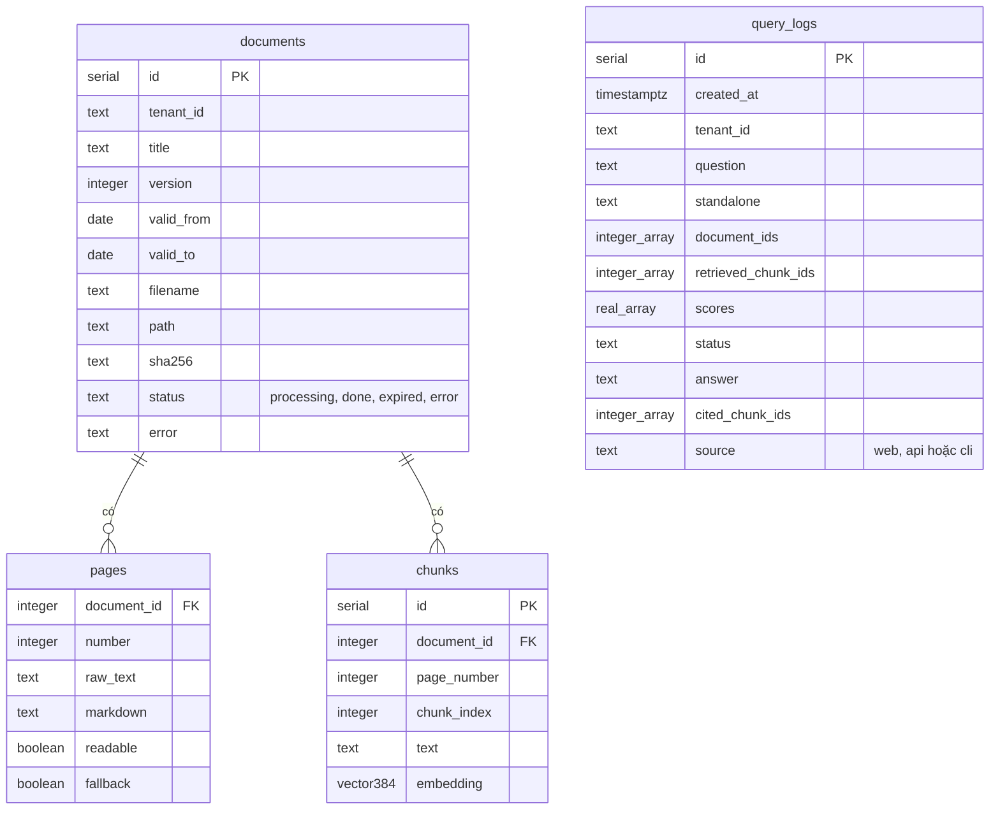

# NUSAskify: hỏi đáp tài liệu nhiều tenant (RAG) bằng Ruby

Nạp file PDF và Word (.docx) kèm metadata (tenant, tiêu đề, phiên bản, ngày hiệu lực), rồi hỏi bằng tiếng Việt hoặc tiếng Anh. Mỗi câu trả lời hiện dần và kèm nguồn: tài liệu, phiên bản, số trang, đoạn trích. Đoạn trích được kiểm tra khớp từng chữ với đoạn đã nạp (bỏ qua dòng kẻ bảng `|---|`). Nếu tài liệu không có thông tin, app trả lời `Không tìm thấy thông tin này trong tài liệu.` và không gọi mô hình.

Trang hỏi đáp là khung chat; mỗi tenant có danh sách tài liệu riêng, chọn tài liệu bằng checkbox, và bảng `Đoạn tìm được` cho thấy từng đoạn với điểm tương đồng. Các cuộc trò chuyện được lưu trên trình duyệt (localStorage, tối đa 50 cuộc, tách theo tenant).

Quyền riêng tư: nội dung tài liệu được gửi tới endpoint DeepSeek khi nạp và khi trả lời; câu hỏi và lịch sử hội thoại gửi kèm cũng được gửi tới đó. Mỗi câu hỏi và câu trả lời cũng được ghi vào bảng `query_logs` trong cơ sở dữ liệu cục bộ. Mô hình tạo vector chạy cục bộ. Web chỉ mở trên `localhost`.

## Báo cáo

### Công nghệ đã chọn

| Thành phần | Lựa chọn | Lý do |
|---|---|---|
| Ngôn ngữ, web | Ruby 3.4, Sinatra, Puma | App gốc đã dùng; một process, không build front-end |
| Vector DB | PostgreSQL 18 + pgvector (`vector(384)`) | Một DB chứa cả metadata, lọc SQL theo tenant, phiên bản, ngày hiệu lực và tìm vector; `<=>` là khoảng cách cosine |
| Embedding | `Xenova/multilingual-e5-small` (384 chiều, chạy cục bộ qua gem `informers`) | Đa ngôn ngữ (Việt, Anh), không tốn tiền cho mỗi lần nạp hay hỏi |
| LLM | DeepSeek qua gateway công ty (dựng lại trang, trả lời, viết lại câu hỏi nối tiếp) | Gọi API, tắt chế độ suy nghĩ để nhanh |
| Rút chữ | `pdftotext` (poppler), LibreOffice đổi `.docx` sang PDF | Mỗi trang đọc được là một đơn vị trang để trích nguồn |
| Chia đoạn | `semantic` (mặc định), `structure` để so sánh | Xem mục so sánh bên dưới |
| API | Sinatra JSON, `/api/docs` (Swagger UI, `swagger-ui-dist@5.17.14` từ CDN) | Tích hợp bằng `curl` hoặc hệ thống khác |
| Chạy | Docker Compose (`app`, `db`) | Một lệnh để dựng môi trường |

Tenant lấy từ `config/tenants.yaml` (`nus`, `acme`, mặc định `nus`); mọi `/api/*` đọc header `X-Tenant-Id` (thiếu hoặc không thuộc danh sách thì 400).

### Sơ đồ luồng

```mermaid
flowchart TD
  subgraph Ingest["Nạp tài liệu (scripts/ingest hoặc tải lên)"]
    F[File PDF/DOCX + metadata: tenant, title, version, valid_from, valid_to] --> V{Metadata hợp lệ?}
    V -- không --> R422[Từ chối, không lưu gì]
    V -- có --> X[Rút chữ từng trang; DOCX đổi sang PDF]
    X --> RS[DeepSeek dựng lại trang thành markdown; kiểm tra số liệu, hỏng thì giữ chữ gốc]
    RS --> CH[Chia đoạn semantic]
    CH --> EM[Embedding cục bộ, 384 chiều]
    EM --> DB[(PostgreSQL: documents, pages, chunks)]
    DB --> EXP[Bản cũ hơn cùng tenant và title chuyển sang expired]
  end
  subgraph Ask["Hỏi đáp (/ask, /api/ask)"]
    Q[Câu hỏi + X-Tenant-Id + document_ids] --> QE[Embedding câu hỏi]
    QE --> SQL[Lọc SQL: đúng tenant, status = done, còn hiệu lực hôm nay, thuộc document_ids]
    SQL --> KNN[Top-k theo cosine, quét chính xác]
    KNN --> G{score hạng 1 >= min_score?}
    G -- không --> NF[Không tìm thấy, KHÔNG gọi LLM]
    G -- có --> LLM[DeepSeek trả lời từ các đoạn tìm được]
    LLM --> CHK[Kiểm tra đoạn trích khớp từng chữ]
    CHK --> A[Trả lời + nguồn]
    NF --> LOG[(query_logs)]
    A --> LOG
  end
```



Retrieval và generation tách riêng: `/api/search` chỉ chạy đến bước `Top-k` (không tốn tiền, trả đoạn và điểm), `/api/ask` chạy hết. Nhờ đó biết lỗi từ đâu: nếu đoạn đúng không có trong `/api/search` thì lỗi ở truy xuất; nếu có mà câu trả lời sai thì lỗi ở sinh câu trả lời.

### Sơ đồ cơ sở dữ liệu



`documents` có ràng buộc `UNIQUE (tenant_id, title, version)`. `query_logs` không có khóa ngoại: nó ghi lại mỗi câu hỏi (kể cả câu bị cổng `min_score` chặn) để xem lại điểm và đoạn đã tìm được.

## Cấu trúc thư mục

```
config/            llm.yaml (mô hình), retriever.yaml (truy xuất, chia đoạn, min_score, giới hạn), tenants.yaml (danh sách tenant), puma.rb
data/
  raw/             tài liệu được nạp (file mẫu đã commit); uploads/<tenant>/ chứa file tải lên
  samples/         nguồn tạo file mẫu: src/*.html, manifest.yml (metadata), upload-demo/
src/
  rag.rb           module Rag, lỗi, kiểu dữ liệu, hằng số (đọc từ config/*.yaml); nạp các file bên dưới
  text.rb, config.rb
  ingestion/       extract, restructurer, ingest, upload, manifest, metadata
  chunking/        chunker (structure), semantic_chunker
  embeddings/      embedder
  vectordb/        store (Postgres + pgvector)
  retrieval/       retriever
  prompts/         câu lệnh gửi mô hình (trả lời, dựng lại trang, viết lại câu hỏi nối tiếp)
  generation/      deepseek (client LLM), ask (trả lời, stream, kiểm tra trích dẫn)
  web/             app.rb (trang web), api.rb và openapi.yaml (/api/*), worker.rb, views/*.erb
evaluation/        questions.yml, check_retrieval, compare_chunking, run_tc
scripts/           ingest, ask, build_samples, test; spikes/ (thử nghiệm và RESULTS.md)
tests/             các file *_test.rb nằm phẳng, trừ support/ và web/
```

Trang đã xử lý và vector nằm trong Postgres (volume Docker `pgdata`). Các file ở gốc: `config.ru`, `Dockerfile`, `docker-compose.yml`, `Gemfile`, `.env.example`.

## 1. Cài đặt (một lần)

Cần Docker với Compose v2.24 trở lên. Mọi lệnh chạy từ thư mục gốc của repo.

```bash
cp .env.example .env
```

Mở `.env`, điền `DEEPSEEK_API_KEY` và `DEEPSEEK_API_BASE` (địa chỉ endpoint của công ty, không có dấu `/` ở cuối). `DEEPSEEK_MODEL` là tùy chọn, mặc định `deepseek-flash`. Không commit file `.env`.

Endpoint của công ty là một gateway (LiteLLM phía trước OpenRouter). Gateway này từ chối trường `thinking` của DeepSeek; trường tắt chế độ suy nghĩ phải là `reasoning: {enabled: false}`, và code đang gửi đúng trường này.

## 2. Chuẩn bị máy trước buổi demo

Bắt đầu từ trạng thái sạch để phần tải file lên ở cuối demo là thật. Schema đã đổi (có `tenant_id`, phiên bản, `query_logs`), nên `docker compose down -v` là bắt buộc một lần; nếu không, `migrate!` báo `Cơ sở dữ liệu có schema cũ`. Chạy lần lượt:

```bash
docker compose down -v
ls data/raw
docker compose run --rm app scripts/ingest
docker compose up -d
```

- `docker compose down -v` xóa CHỈ dữ liệu của dự án này: volume cơ sở dữ liệu (`pgdata`) và volume cache mô hình (`models`). Mô hình tạo vector được tải lại. Code không bị xóa.
- `ls data/raw` hiện 5 file mẫu: `acme-quy-dinh-lam-viec-tu-xa.docx`, `quy-che-nghi-phep-v1.pdf`, `quy-che-nghi-phep.pdf`, `quy-dinh-lam-viec-tu-xa.docx`, `travel-expense-policy.pdf`, cộng thêm file lạ nếu có. Metadata của file mẫu nằm trong `data/samples/manifest.yml`. File không có trong manifest được `scripts/ingest` báo là `Bỏ qua (thiếu metadata)` và không tốn lệnh gọi trả phí. `scripts/ingest` không quét `data/raw/uploads/`: file tải lên qua web hoặc API chỉ được nạp qua đường tải lên.
- Chạy `scripts/ingest` TRƯỚC `up -d`: lệnh này tự khởi động cơ sở dữ liệu, tải mô hình một lần rồi nạp. Làm ngược lại thì hai container có thể cùng tải mô hình vào một cache.
- Lần nạp đầu gọi DeepSeek một lần cho mỗi trang (4 trang mỗi file mẫu, 20 trang cho 5 file). Lần chạy đầu cũng build image và tải image Postgres, mất vài phút: hãy làm trước giờ demo.
- Kết quả của `scripts/ingest` từ trạng thái trống trên bản clone sạch (trước dòng `OK:` có thể có dòng tiến độ tải mô hình và một dòng `onnxruntime cpuid_info warning`, vô hại):

```
OK: acme-quy-dinh-lam-viec-tu-xa.docx, quy-che-nghi-phep-v1.pdf, quy-che-nghi-phep.pdf, quy-dinh-lam-viec-tu-xa.docx, travel-expense-policy.pdf
```

- File nào nằm trong `data/raw/` mà không có metadata trong manifest sẽ hiện thành `Bỏ qua (thiếu metadata): <tên file>` và không được nạp.
- Chạy lại thì các file không đổi được bỏ qua và không tốn lệnh gọi trả phí (`Bỏ qua (không đổi): ...`).
- Sau khi nạp, `quy-che-nghi-phep-v1.pdf` (phiên bản 1, hiệu lực 2024-2025) có trạng thái `expired`, còn `quy-che-nghi-phep.pdf` (phiên bản 2) là `done`; `acme-quy-dinh-lam-viec-tu-xa.docx` thuộc tenant `acme`.

Sau `up -d`, chờ vài giây cho đến khi `docker compose logs app` hiện dòng `* Listening on http://0.0.0.0:4567`, rồi mở http://localhost:4567.

Sau phần demo tải lên, xóa tài liệu đó trên trang `Tài liệu` (nút xóa) hoặc `curl -X DELETE localhost:4567/api/documents/<id> -H 'X-Tenant-Id: nus'`. Xóa chỉ gỡ file nằm dưới `data/raw/uploads/`, không bao giờ đụng vào file mẫu trong `data/raw/`. Lần chạy thử viết báo cáo này đã xóa bản tải lên theo cách đó và `data/raw/uploads/` không còn file nào.

## 3. Kịch bản demo

Các câu bên dưới đã được hỏi lại trên dữ liệu vừa nạp (chia đoạn semantic) qua `/api/ask`, gồm cả câu `acme` ở bước 4 (trả "tối đa 4 ngày", tài liệu của `acme`); riêng bước 3 (xem trang) và việc tải lên bằng form web chưa chạy tay trong lần viết báo cáo này (tải lên được thử qua API). Lời mô hình có thể khác chữ, nhưng ý và nguồn phải như dưới đây.

1. Hỏi khác chữ với tài liệu (tenant `nus`, chọn tất cả tài liệu): `Ngày phép năm ngoái dùng không hết thì được giữ lại sang năm nay mấy ngày?`
   Đã quan sát: "chuyển tối đa 5 ngày sang năm kế tiếp", dùng trước 31/03; nguồn `Quy chế nghỉ phép v2 · trang 2`. Tài liệu viết "chưa dùng hết ... chuyển sang năm kế tiếp", câu hỏi viết khác, vẫn tìm ra (đoạn đúng xếp hạng 1, điểm 0,891): đó là tìm theo nghĩa.
2. Câu hỏi về bảng: `Tôi sắp lấy vợ thì được nghỉ có lương mấy ngày?`
   Đã quan sát: "nghỉ 3 ngày làm việc có lương"; nguồn `Quy chế nghỉ phép v2 · trang 3`. Đoạn trích là dòng bảng của chữ gốc (các cột cách nhau bằng khoảng trắng): `Bản thân kết hôn nghỉ 3 ngày làm việc ...`, không phải dòng `|`. Với bảng ở file khác, ví dụ `What is the hotel limit per night in a Tier 1 city?`, nguồn là dòng markdown `| Tier 1 (capital cities and major financial centres) | USD 140 per night | USD 60 per day |` (`Travel expense policy v1 · trang 2`).
3. Bấm vào nguồn `[1]`. Trang Tài liệu mở ra đúng trang, hai cột: `Chữ gốc` (chữ rút từ PDF) và `Markdown (DeepSeek dựng lại)`. Đây là chỗ để người xem tự đối chiếu. Trang bị đánh dấu `Đã dùng chữ gốc vì markdown thiếu số liệu` nghĩa là bước dựng lại làm mất số và app đã giữ chữ gốc.
4. Đổi tenant: chọn `acme` trên danh sách tenant, các checkbox đổi thành tài liệu của `acme` và cuộc trò chuyện của `nus` không hiện. Hỏi `Một tuần được làm việc từ xa tối đa mấy ngày?`: `nus` ra tài liệu của `nus` (2 ngày), `acme` ra tài liệu của `acme` (4 ngày) (TC5).
5. Câu hỏi không có đáp án: `Công ty thưởng Tết bao nhiêu tháng lương?`
   Đã quan sát: `not_enough_information`, không có nguồn, không gọi mô hình.
6. Tải file lên: trang `Tài liệu`, chọn `data/samples/upload-demo/chinh-sach-hoan-tien.docx`, nhập tên `Chính sách hoàn tiền`, phiên bản `1`, hiệu lực từ `2026-01-01` đến `2099-12-31`, bấm `Tải lên`. Trạng thái `đang xử lý`, rồi `xong`. Rồi hỏi: `Hàng về tay được 10 ngày rồi, giờ muốn trả thì được hoàn bao nhiêu phần trăm?`
   Đã quan sát (tải lên qua API với cùng metadata): "từ 8 đến 15 ngày kể từ khi nhận hàng thì được hoàn 70%", nguồn `Chính sách hoàn tiền · trang 2 (bản PDF)`, trích `| Từ 8 đến 15 ngày | hoàn 70% |`. Điểm hạng 1 của câu này là 0,880 (đoạn bảng hoàn tiền), trên ngưỡng `min_score` 0,84. Thời gian trong một lần chạy thử: `xong` sau khoảng 16 giây (3 trang, 19 đoạn). Đây là số quan sát được một lần, không phải cam kết. Số trang của nguồn `.docx` là số trang của bản PDF đã chuyển đổi.

## 4. Kết quả đánh giá

Mọi số trong mục này lấy từ lệnh chạy trên dữ liệu vừa nạp từ trạng thái trống (5 tài liệu, tenant `nus` có 3 tài liệu hiện hành, `chunking: semantic`).

### 4.1 Truy xuất và ngưỡng `min_score`

`evaluation/questions.yml` có 10 câu hỏi có đáp án trong 3 file mẫu hiện hành của `nus`, 1 câu có đáp án trong file tải lên (`after_upload: true`), 2 câu không có đáp án, và 2 câu cho TC5 (cùng câu, hai tenant). Mỗi câu có `file`, `contains` (cụm chữ phải có trong đoạn tìm được); các câu dùng cho test case có nhãn `tc`.

```bash
docker compose run --rm app evaluation/check_retrieval
```

Kết quả: `answerable top-1 min=0.851 | unanswerable top-1 max=0.832 | in top 6: 12/12`. Hạng của đoạn đúng là 1 cho mọi câu, trừ câu "Tôi sắp lấy vợ ..." (đoạn đúng xếp hạng 2; điểm 0,897 là điểm của hạng 1). Điểm hạng 1 cao nhất của câu không có đáp án là 0,832 (cả hai câu); thấp nhất của câu có đáp án là 0,851 (câu "Sáng nay tôi bị sốt, phải báo sếp chậm nhất mấy giờ?").

`min_score = 0.84` trong `config/retriever.yaml` là trung điểm của 0,832 và 0,851 (0,8415). Hai khoảng không chồng nhau, nhưng biên mỏng (0,008 phía dưới, 0,011 phía trên): với câu hỏi mới, ngưỡng này có thể chặn nhầm câu có đáp án hoặc để lọt câu không có đáp án. Câu bị chặn không gọi mô hình. Câu tải lên (0,880) vẫn qua ngưỡng; câu có đáp án thấp thứ hai, "Do I need a receipt for a USD 40 taxi ride?", được 0,856. `/api/search` không áp ngưỡng, nên số trên không đổi khi chỉnh ngưỡng.

### 4.2 So sánh chia đoạn: semantic và structure

```bash
docker compose run --rm app evaluation/compare_chunking
```

| strategy | số đoạn | ký tự trung bình | hit@6 | hạng của đoạn đúng theo từng câu (11 câu) |
|---|---|---|---|---|
| structure (theo tiêu đề, đoạn văn, bảng) | 22 | 587 | 11/11 | 1, 1, 1, 2, 1, 1, 1, 1, 1, 1, 1 |
| semantic (cắt khi ngữ nghĩa đổi; percentile 25, sàn 0,85, tối thiểu 5 đơn vị) | 74 | 173 | 11/11 | 1, 1, 2, 1, 1, 1, 1, 1, 1, 1, 1 |

Cùng hit@6; hạng chỉ lệch ở một câu mỗi bên (structure xếp hạng 2 ở câu thứ 4, semantic xếp hạng 2 ở câu thứ 3). Semantic cho đoạn nhỏ hơn khoảng 3,4 lần (173 so với 587 ký tự), nên mỗi đoạn tập trung một ý; đổi lại có nhiều đoạn hơn (74 so với 22) và lúc nạp phải embedding từng câu để tìm điểm cắt. Mẫu 11 câu quá nhỏ để kết luận semantic chính xác hơn: số liệu chỉ cho thấy hai cách ngang nhau trên bộ này. Semantic là mặc định (`chunking: semantic`), `structure` giữ để so sánh.

### 4.3 TC1 đến TC8

```bash
docker compose run --rm app evaluation/run_tc
```

Kết quả (thoát mã 0):

```
TC | PASS/FAIL | detail
TC1 | PASS | right chunk in top 6: true, status=answered, cites it: true, answer has 5: true
    #1 Quy chế nghỉ phép v2 p2 0.891 Phê duyệt.** Người quản lý trực tiếp phải trả lời đơn nghỉ p
    #2 Quy chế nghỉ phép v2 p2 0.858 ## Chương II. Nghỉ phép năm **Điều 6.  Số ngày nghỉ phép năm
    #3 Quy chế nghỉ phép v2 p4 0.852 Điều 16. Nghỉ không phép. Nghỉ không có đơn được phê duyệt b
TC2 | PASS | right chunk in top 3: true
TC3 | PASS | status=not_enough_information, citations=0
TC4 | PASS | expired document ids=[2], ids seen=[3, 4], right current chunk present: true
TC5 | PASS | acme ids=[1], acme results=[1], nus results=[4, 3]
TC6 | PASS | selected=[5], ids seen=[5]
TC7 | PASS | status=answered, citations=1, unverified=0
TC8 manual (see README)
```

Ba dòng `#1..#3` do TC2 in ra, trước dòng kết quả TC2 của nó (vì vậy nằm dưới dòng TC1).

| TC | Kiểm tra | Kết quả | Chẩn đoán |
|---|---|---|---|
| TC1 | Hỏi trong `nus`: đoạn đúng có trong top 6, câu trả lời có số 5 và trích dẫn đúng đoạn đó | PASS | Truy xuất đúng (hạng 1) và sinh đúng ("tối đa 5 ngày") |
| TC2 | Câu hỏi khác chữ với tài liệu, đoạn đúng nằm trong top 3 | PASS | Tìm theo nghĩa, xem bên dưới |
| TC3 | Câu không có trong tài liệu (`Công ty thưởng Tết ...`) | PASS | Cổng `min_score` chặn (điểm hạng 1 là 0,832 < 0,84), không gọi LLM |
| TC4 | Bản cũ `expired` (id 2) không xuất hiện trong search hay ask; đoạn đúng của bản hiện hành có mặt | PASS | Lọc SQL theo `status` và ngày hiệu lực, trước khi xếp hạng |
| TC5 | Cùng câu hỏi: `nus` chỉ ra tài liệu 4, 3 (2 ngày), `acme` chỉ ra tài liệu 1 (4 ngày) | PASS | Lọc SQL theo `tenant_id` |
| TC6 | Chọn một tài liệu (id 5), kết quả chỉ chứa tài liệu đó, dù câu hỏi (tiền mạng) thuộc tài liệu khác | PASS | Lọc SQL theo `document_ids` |
| TC7 | Mọi trích dẫn khớp từng chữ với đoạn đã tìm được | PASS | Kiểm tra bằng code sau khi sinh (chuẩn hóa NFC, bỏ dòng kẻ bảng) |
| TC8 | Đoạn "giống nhất" không phải đáp án | xem 4.4 | Lỗi truy xuất; cổng `min_score` chặn nên không bịa đáp án |

TC2: lệnh sau trả top 3 cho câu `Ngày phép năm ngoái dùng không hết thì được giữ lại sang năm nay mấy ngày?` (nội dung cắt cho gọn):

```bash
curl -s -X POST localhost:4567/api/search -H 'X-Tenant-Id: nus' -H 'content-type: application/json' \
  -d '{"question":"Ngày phép năm ngoái dùng không hết thì được giữ lại sang năm nay mấy ngày?","document_ids":[],"top_k":3}'
```

| Hạng | Tài liệu, trang | Điểm | Nội dung |
|---|---|---|---|
| 1 | Quy chế nghỉ phép v2, trang 2 | 0,891 | `Phê duyệt.** Người quản lý trực tiếp phải trả lời đơn nghỉ phép trong vòng 1 ngày làm việc ...` (đoạn này gồm cả Điều 9 "Ngày phép chưa dùng hết trong năm được chuyển tối đa 5 ngày sang năm kế tiếp ...", chính là chunk 59 mà câu trả lời trích) |
| 2 | Quy chế nghỉ phép v2, trang 2 | 0,858 | `## Chương II. Nghỉ phép năm **Điều 6. Số ngày nghỉ phép năm ...` |
| 3 | Quy chế nghỉ phép v2, trang 4 | 0,852 | `Điều 16. Nghỉ không phép. Nghỉ không có đơn được phê duyệt ...` |

Câu hỏi và đoạn đúng gần như không chung cụm từ: câu hỏi nói "năm ngoái", "dùng không hết", "giữ lại", "sang năm nay"; tài liệu nói "chưa dùng hết trong năm", "được chuyển", "sang năm kế tiếp". Tìm theo từ khóa dễ lỡ vì cụm từ không trùng; mô hình embedding đa ngôn ngữ đặt hai câu cùng ý gần nhau trong không gian vector, nên đoạn này có điểm cao nhất (0,891). Điểm hạng 2 và 3 chỉ kém 0,03 đến 0,04: ngưỡng chỉ phân biệt tốt khi điểm chênh lớn, đây là lý do biên ở 4.1 mỏng.

### 4.4 TC8: đoạn giống nhất không phải đáp án

Các câu đã thử bằng `/api/search`: `What is the hotel limit per night in a Tier 2 city?` (hạng 1 là đoạn bảng chứa cả ba hạng thành phố; `/api/ask` trả USD 110: không phải lỗi) và `Do I need a receipt for a USD 20 taxi ride?` (hạng 1 là mục 3.1 và 3.2 về hóa đơn, có chữ "USD 25"; hạng 2 là mục 2.2 về taxi; chưa gọi `/api/ask`). Lỗi thật đầu tiên là câu sau:

```bash
curl -s -X POST localhost:4567/api/search -H 'X-Tenant-Id: nus' -H 'content-type: application/json' \
  -d '{"question":"Chi phí khách sạn vượt mức trần thì ai trả?","document_ids":[],"top_k":6}'
```

Đáp án nằm ở tài liệu tiếng Anh `Travel expense policy`, mục 2.5 "Exceeding the caps. An amount above the cap is paid by the employee unless the department director approved the higher amount before the booking." (chunk 111). Câu hỏi bằng tiếng Việt về tài liệu tiếng Anh. Kết quả với `top_k = 6`:

| Hạng | chunk | Tài liệu, trang | Điểm | Nội dung |
|---|---|---|---|---|
| 1 | 92 | Quy định làm việc từ xa, trang 3 | 0,826 | `Mục 3.5. Hỗ trợ chi phí. Công ty hỗ trợ chi phí internet và điện ...` |
| 2 | 90 | Quy định làm việc từ xa, trang 3 | 0,826 | `khách sạn. Mục 3.3. Bảo mật tài liệu ...` |
| 3 | 98 | Quy định làm việc từ xa, trang 4 | 0,817 | `trước đó. Mọi đề xuất sửa đổi gửi đến Phòng Nhân sự.` |
| 4 | 59 | Quy chế nghỉ phép v2, trang 2 | 0,811 | `Phê duyệt.** Người quản lý trực tiếp ...` |
| 5 | 50 | Quy chế nghỉ phép v2, trang 1 | 0,804 | `QUY CHẾ NGHỈ PHÉP Công ty Cổ phần Trà Xanh Demo ...` |
| 6 | 56 | Quy chế nghỉ phép v2, trang 2 | 0,802 | `**Điều 7.` |

Chunk 111 (đáp án) không có trong top 6, và cũng không có trong top 20. Hạng 1 là đoạn "hỗ trợ chi phí" của tài liệu làm việc từ xa, chỉ giống ở chữ "chi phí" và không trả lời câu hỏi. Chẩn đoán: LỖI TRUY XUẤT (đoạn đúng vắng mặt), không phải lỗi sinh câu trả lời, vì LLM chưa hề thấy đoạn đúng. Nguyên nhân khả dĩ (chưa kiểm chứng riêng): câu hỏi tiếng Việt và đoạn tiếng Anh khác ngôn ngữ nên điểm tương đồng thấp.

`/api/ask` với cùng câu trả `status: not_enough_information`, `answer: "Not enough information in the documents."` và không có trích dẫn: điểm hạng 1 là 0,826 < 0,84 nên cổng `min_score` chặn trước khi gọi LLM. Cổng đã làm đúng việc (không bịa câu trả lời từ đoạn sai), nhưng người dùng nhận "không tìm thấy" dù tài liệu có đáp án: đó là một lần bỏ sót. Cách tránh: hỏi bằng tiếng Anh, hoặc thêm bước dịch hay viết lại câu hỏi (chưa làm).

Cách phân biệt lỗi ở đâu: gọi `/api/search` với đúng câu hỏi và xem đoạn đúng có trong danh sách không. Không có thì sửa truy xuất (chia đoạn, mô hình embedding, ngưỡng); có mà `/api/ask` trả sai thì xem câu trả lời, trích dẫn và prompt (lỗi sinh).

### 4.5 Sử dụng API

Mọi `/api/*` cần header `X-Tenant-Id` (`nus` hoặc `acme`); thiếu hoặc không thuộc danh sách thì 400 `{"error": ...}`. Tài liệu đầy đủ và "Try it out" ở http://localhost:4567/api/docs (đặc tả ở `/api/openapi.yaml`). Các ví dụ:

```bash
# liệt kê tài liệu của tenant (thêm ?current=true để chỉ lấy bản còn hiệu lực)
curl -s localhost:4567/api/documents -H 'X-Tenant-Id: nus'

# tải lên (multipart; 202 trả {id, status}; theo dõi status ở GET /api/documents)
curl -s -X POST localhost:4567/api/documents -H 'X-Tenant-Id: nus' \
  -F file=@data/samples/upload-demo/chinh-sach-hoan-tien.docx \
  -F title='Chính sách hoàn tiền' -F version=1 -F valid_from=2026-01-01 -F valid_to=2099-12-31

# xem các đoạn của một tài liệu
curl -s localhost:4567/api/documents/3/chunks -H 'X-Tenant-Id: nus'

# chỉ truy xuất (không gọi LLM, không tốn tiền); document_ids rỗng nghĩa là mọi tài liệu của tenant
curl -s -X POST localhost:4567/api/search -H 'X-Tenant-Id: nus' -H 'content-type: application/json' \
  -d '{"question":"What is the hotel limit per night in a Tier 1 city?","document_ids":[],"top_k":3}'

# hỏi đáp (gọi LLM): status answered hoặc not_enough_information, kèm citations và chunks có điểm
curl -s -X POST localhost:4567/api/ask -H 'X-Tenant-Id: nus' -H 'content-type: application/json' \
  -d '{"question":"What is the hotel limit per night in a Tier 1 city?","document_ids":[5]}'

# xóa (chỉ gỡ file dưới data/raw/uploads/)
curl -s -X DELETE localhost:4567/api/documents/6 -H 'X-Tenant-Id: nus'
```

Điểm (`score`) là `1 - khoảng cách cosine` (pgvector `<=>`), làm tròn 3 chữ số. `document_ids` thuộc tenant khác hoặc không tồn tại trả về danh sách rỗng, không rơi về "mọi tài liệu". Giới hạn: file 30 MB, thân JSON 64 KB.

### 4.6 Bộ câu hỏi chạy tay

Chất lượng câu trả lời của các câu còn lại không được đánh giá tự động: hãy hỏi tay từng câu trong `evaluation/questions.yml` và so với `file`, `contains`.

## 5. Phát triển

```bash
docker compose run --rm app scripts/test                 # chạy toàn bộ test (không gọi DeepSeek, không tải mô hình)
docker compose run --rm app scripts/ask "câu hỏi"        # dùng lõi không qua web (có gọi DeepSeek)
```

Container chạy bằng người dùng thường (`app`, uid 1000) và mã nguồn được mount CHỈ ĐỌC (`.:/app:ro`); chỉ `data/raw/` (file tải lên) và cache mô hình `/cache` ghi được. Sửa mã trên máy vẫn có hiệu lực khi chạy lại lệnh; riêng web cần `docker compose restart app`. Lệnh cần ghi vào repo (tạo lại file mẫu, cập nhật `Gemfile.lock`, các script trong `scripts/spikes/`) phải chạy một lần với mount ghi được. Lưu ý: `docker compose run -v` KHÔNG ghi đè được mount chỉ đọc, nên dùng `docker run` với image `app` đã build (không có cơ sở dữ liệu, đủ cho các lệnh này):

```bash
docker run --rm -v "$PWD:/app" -w /app app scripts/build_samples   # tạo lại file mẫu từ data/samples/src
```

`scripts/build_samples` là nguồn của `data/raw/` và `data/samples/upload-demo/`: không sửa tay các file đó. Nếu file mẫu tạo lại khác byte so với bản đang nạp (sha256 đổi) thì lần `scripts/ingest` sau sẽ nạp lại và tốn lệnh gọi trả phí.

## 6. Xử lý sự cố

- Trình duyệt báo 403: bạn đang vào bằng tên máy không phải `localhost`, `127.0.0.1` hay `[::1]`. Dùng `http://localhost:4567`.
- Thiếu file `.env` hoặc thiếu biến trong file đó: container web thoát ngay khi khởi động, thông báo tiếng Việt nằm trong `docker compose logs app`. Điền `DEEPSEEK_API_KEY` và `DEEPSEEK_API_BASE`.
- Sai key hoặc endpoint: trang chỉ hiện `Không thể trả lời lúc này. Vui lòng thử lại sau.`; lý do nằm trong `docker compose logs app`.
- Sau khi sửa `.env`, chạy `docker compose up -d --force-recreate app` để container nhận giá trị mới.
- File PDF scan: không có OCR, trang không có lớp chữ được báo là không đọc được; file chỉ toàn trang như vậy báo lỗi `file scan, không đọc được`.
- File ở trạng thái `lỗi: bị gián đoạn, hãy tải lại file hoặc chạy lại lệnh nạp` (do khởi động lại giữa lúc xử lý): chạy lại `docker compose run --rm app scripts/ingest`, hoặc tải file lên lại.
- Muốn xóa sạch dữ liệu và cache mô hình: làm lại các lệnh ở mục 2 (`down -v`, `scripts/ingest`, `up -d`). `down -v` không xóa file đã tải lên trong `data/raw/uploads/`; xóa chúng bằng nút xóa hoặc `DELETE /api/documents/:id` trước khi `down -v`.
- Báo `Cơ sở dữ liệu có schema cũ`: dữ liệu được tạo bằng bản trước NUSAskify; chạy `docker compose down -v` một lần rồi nạp lại.
- Đổi mô hình tạo vector (`embed_model` trong `config/retriever.yaml`) cần `docker compose down -v` rồi nạp lại.
- `disable_reasoning` trong `config/llm.yaml` mặc định `true` (tắt chế độ suy nghĩ của mô hình, để chữ đầu tiên hiện nhanh hơn; số đo nằm trong `scripts/spikes/RESULTS.md`). Đặt `false` thì bật lại.
- Dừng app sau demo: `docker compose stop`.

## 7. Giới hạn đã biết

- Không có đăng nhập; chỉ chạy trên `localhost`. Header `X-Tenant-Id` chỉ là mô phỏng tenant, không phải xác thực: ai gọi được API đều chọn được tenant bất kỳ.
- Trang xem tài liệu `/documents/:id` (HTML) không lọc theo tenant: biết id là xem được trang của tenant khác. API (`/api/*`) thì có lọc.
- Lọc theo tenant, phiên bản và ngày dùng quét chính xác (exact scan) trong pgvector, không có chỉ mục ANN (HNSW/IVFFlat): đủ cho vài trăm đoạn của demo, chưa kiểm tra với corpus lớn.
- Cổng `min_score` hiệu chỉnh trên 12 câu và có biên mỏng (xem 4.1); câu hỏi khác ngôn ngữ với tài liệu có thể bị chặn nhầm (xem TC8 ở 4.4).
- Ngày hiệu lực được đánh giá theo ngày của server khi hỏi, không có múi giờ riêng cho từng tenant.
- Không OCR: trang scan được báo là không đọc được.
- Ngữ cảnh hội thoại nằm trên trình duyệt: server không dùng lại gì giữa các lần gọi ngoài lịch sử mà trình duyệt gửi kèm. Tuy nhiên mỗi câu hỏi và câu trả lời (kể cả của `/api/ask` và `scripts/ask`) được ghi vào bảng `query_logs` trong cơ sở dữ liệu, kèm tenant, điểm và đoạn tìm được; không có cơ chế tự xóa. Server chỉ dùng 3 lượt gần nhất của hội thoại gửi kèm, mỗi câu hỏi cắt còn 1 000 ký tự và mỗi câu trả lời còn 2 000 ký tự.
- Câu hỏi nối tiếp được viết lại thành câu độc lập bằng mô hình; nếu viết lại sai thì câu trả lời sai theo. Câu viết lại được hiện dưới dòng "Hiểu là:" để người dùng kiểm tra.
- Nội dung tài liệu được gửi tới endpoint mô hình khi nạp và khi trả lời.
- Kiểm tra số sau khi dựng lại bắt được số bị đổi hoặc bị mất, nhưng không bắt được hai số bị hoán đổi cho nhau, và không kiểm tra được trang không có số. Cách kiểm tra là xem trang hai cột.
- Đoạn trích hiển thị đã được kiểm tra khớp từng chữ với đoạn được dẫn. Nguồn nào không xác minh được đoạn trích thì hiển thị `không xác minh được đoạn trích`.
- File không phải Word nhưng đổi đuôi thành `.docx` và bắt đầu bằng chữ ký zip có thể bị nạp thành chữ rác.
- Tải lên tối đa 30 MB, chỉ `.pdf` và `.docx`.
- Mỗi tài liệu tối đa 200 trang (mỗi trang đọc được là một lệnh gọi trả phí); quá 200 trang thì báo lỗi `Tài liệu quá dài (tối đa 200 trang).` trước khi gọi mô hình. Trang dài hơn 20.000 ký tự không được gửi đi dựng lại: giữ nguyên chữ gốc (trang tài liệu vẫn hiện nhãn `Đã dùng chữ gốc vì markdown thiếu số liệu`, dù lý do ở đây là trang quá dài).
- Tài liệu đang xử lý mà app khởi động lại sẽ hiện là bị gián đoạn: phải tải lên lại hoặc nạp lại.
- Đổi mô hình tạo vector phải xóa dữ liệu và nạp lại.

## 8. Đưa lõi vào hệ thống thật

Lõi là TOÀN BỘ thư mục `src/` trừ `src/web/`: ba file nằm thẳng trong `src/` (`rag.rb`, `text.rb`, `config.rb`) và mọi thư mục con. Chưa đóng gói thành gem: hãy copy phần này vào MỘT thư mục riêng của dự án Ruby/Rails, ví dụ `lib/rag/`, không chứa gì khác, vì `rag.rb` tự `require` mọi file `.rb` dưới thư mục của nó (trừ thư mục con `web/`). Loại thư mục đó khỏi autoloader của hệ thống (với Rails là Zeitwerk: tên file không theo quy ước đặt tên của nó) và nạp bằng đúng một lệnh `require` file `rag.rb`. Ba file cấu hình `llm.yaml`, `retriever.yaml` và `tenants.yaml` phải nằm trong thư mục `config/` NGANG HÀNG với thư mục đó, vì `rag.rb` đọc `File.expand_path("../config", __dir__)`: với lõi ở `lib/rag/` thì các file là `lib/config/llm.yaml`, `lib/config/retriever.yaml` và `lib/config/tenants.yaml`. Thiếu file, thiếu khóa hoặc sai kiểu giá trị thì lỗi ngay khi nạp. `src/web/`, `scripts/`, `evaluation/` và `config.ru` chỉ là phần demo.

Hai điểm vào, mỗi điểm nhận ba thành phần truyền từ ngoài:

```ruby
report = Rag::Ingest.new(llm:, embedder:, store:).call(path, metadata)   # path là file hoặc thư mục; metadata là Rag::Meta cho một file, hoặc { tên file => Rag::Meta } cho thư mục
answer = Rag::Ask.new(llm:, embedder:, store:).call(question, history, tenant_id:, document_ids:, source:) { |delta| ... }  # history, tenant_id:, document_ids:, source: và block là tùy chọn; history là mảng {q:, a:}
```

- `Rag::Report` có bốn thành phần: `ok`, `skipped`, `failed` (mảng `[tên file, thông báo]`), `empty_dir`; cùng `failed?` và `summary`. `Ingest` không báo lỗi bằng exception theo từng file mà ghi vào `failed`.
- `Rag::Answer` có `text`, `found`, `sources`, `standalone` (câu hỏi đã dùng để truy xuất: câu đã viết lại, hoặc chính câu hỏi ở lượt đầu), `hits` (các đoạn đã tìm được, kèm điểm) và `status` (`answered` hoặc `not_enough_information`); mỗi `Rag::Source` có `n`, `filename`, `page`, `quote` (`nil` nếu không xác minh được), `chunk_id`, `document_id`, `title`, `version`. Khi `found` là false thì không có nguồn.
- Từ lượt thứ hai có `history`, `Ask` gọi LLM thêm một lần (không stream) để viết lại câu hỏi nối tiếp thành câu độc lập, rồi truy xuất bằng câu đó. Mỗi câu hỏi nối tiếp vì vậy tốn hai lệnh gọi trả phí. Prompt trả lời không nhận lịch sử, nên câu hỏi về chính câu trả lời trước ("tóm tắt lại", "giải thích ý thứ 2") sẽ ra `Không tìm thấy thông tin này trong tài liệu.`, đúng theo thiết kế.
- Phần trả lời được stream qua block; phần trích dẫn do mô hình in sau dấu `Rag::Ask::TOKEN` (`<<QUOTES>>`) bị lọc ra khỏi stream và được kiểm tra bằng code.

Ba thành phần cần có các phương thức sau (tên đúng như trong code):

- `llm`: `chat(messages, &on_delta)`. `messages` là mảng `{role:, content:}`. Có block thì stream, gọi block với từng đoạn chữ rồi trả về toàn bộ chữ; không có block thì trả chuỗi. Lỗi nên là lớp con của `Rag::Error`: message của nó được `scripts/ask` in ra và được ghi làm lý do trạng thái khi nạp. Trang hỏi đáp trên web luôn chỉ hiện thông báo cố định `Không thể trả lời lúc này. Vui lòng thử lại sau.`
- `embedder`: `embed_passages(texts)` trả mảng vector (cho đoạn tài liệu), `embed_query(text)` trả một vector (cho câu hỏi). Kích thước vector là `Rag::EMBED_DIM` (384).
- `store`: `find_document(tenant_id:, title:, version:)`, `start_document(tenant_id:, title:, version:, valid_from:, valid_to:, filename:, path:, sha256:)` (trả id), `finish_document(id, pages:, chunks:)`, `fail_document(id, message)`, `search(embedding, k, tenant_id:, document_ids:, on:)` (trả mảng `Rag::Hit`; `on` là ngày dùng để kiểm tra hiệu lực). Web demo còn dùng `documents(tenant_id:)`, `document(id, tenant_id:)` và `pages(document_id)`. Hợp đồng mà lõi dựa vào: `search` chỉ trả đoạn của tài liệu có trạng thái `"done"`, đúng `tenant_id`, đang còn hiệu lực vào ngày `on`, và thuộc `document_ids` nếu danh sách không rỗng (rỗng là mọi tài liệu của tenant); các trạng thái là `"processing"`, `"done"`, `"expired"`, `"error"`; nạp chỉ bỏ qua khi sha256 trùng VÀ trạng thái là `"done"` hoặc `"expired"`; `start_document` thay thế bản ghi cũ cùng `(tenant_id, title, version)`, cùng với trang và đoạn của nó; `finish_document` ghi trang, đoạn và trạng thái `"done"` trong một giao dịch nguyên tử, đồng thời chuyển các phiên bản thấp hơn của cùng `(tenant_id, title)` sang `"expired"`. Kiểu dữ liệu: `Rag::Page`, `Rag::Chunk`, `Rag::Doc`, `Rag::Hit` trong `src/rag.rb`.

Thay thế:

- Thay `Rag::Store` (Postgres và pgvector) bằng lớp lưu trữ của hệ thống thật, cài đủ các phương thức trên.
- Thay `Rag::DeepSeek` bằng client LLM của hệ thống. Nếu hệ thống gọi thẳng DeepSeek (không qua gateway công ty), phải đổi trường trong `src/generation/deepseek.rb` từ `reasoning: {enabled: false}` về `thinking: {type: "disabled"}`; đặt `DEEPSEEK_MODEL` thành mã mô hình DeepSeek thật (`deepseek-flash` ở đây là tên gọi riêng của gateway); và kiểm tra địa chỉ gốc có cần tiền tố đường dẫn không, vì code chỉ nối thêm `/chat/completions`.
- Giữ nguyên bước kiểm tra đoạn trích và kiểm tra con số: đó là thứ làm cho câu trả lời đáng tin.

Phụ thuộc: gem `informers` (mô hình `Xenova/multilingual-e5-small`), `pg`, `pgvector` (chỉ khi dùng `Rag::Store`); gói hệ thống `poppler-utils` (rút chữ PDF), LibreOffice Writer (`libreoffice-writer-nogui`) cùng font `fonts-noto-core` và `fonts-liberation2` (để dấu tiếng Việt đúng khi đổi `.docx` sang PDF; chỉ cần cho `.docx`); và Ruby 3.4. Xem `Dockerfile` và `Gemfile`.

Trước khi đưa vào môi trường thật:

- Chạy bước chuyển tài liệu (LibreOffice, pdftotext) trong sandbox không có mạng; tài liệu độc hại có thể làm LibreOffice truy cập mạng (demo đã chặn ảnh liên kết ngoài, nhưng sandbox mới là lớp chắn đúng).
- Thêm đăng nhập, và giới hạn mọi truy vấn của store theo chủ sở hữu tài liệu.
- Lưu file tải lên dưới tên do hệ thống tự sinh (id), không dùng tên file của người dùng.
- Giới hạn tần suất và ngân sách chi phí cho `POST /ask` (mỗi câu hỏi là lệnh trả phí, câu nối tiếp tốn thêm một lệnh để viết lại).
- Ghim phiên bản (revision) của mô hình tạo vector và digest của các image Docker.
- Từ chối endpoint mô hình không phải https.
- Giữ tự động escape HTML trong view của hệ thống (view demo phải tự gọi `h(...)`).

Demo bỏ qua: đăng nhập và phân quyền, mở rộng tải, và OCR.
